# 🇰🇷 TÀI LIỆU BÁO CÁO TOÀN DIỆN HỆ THỐNG HỌC TIẾNG HÀN (KOREAN LEARNING HUB)
### *Dành Cho AI Chuyên Gia / Senior EdTech Engineer / K-Linguistics Specialist Review & Đóng Góp Ý Kiến*

> **Phiên bản hệ thống**: `v1.0.10`  
> **Thời điểm cập nhật**: Tháng 10/2026  
> **Mục đích tài liệu**: Tài liệu này tổng hợp toàn bộ các tính năng đã hoàn thiện, kiến trúc kỹ thuật, triết lý sư phạm, thuật toán đã cài đặt và các câu hỏi trọng tâm nhằm phục vụ cho việc gửi trực tiếp đến các AI chuyên gia khác (ChatGPT, Claude 3.5 Sonnet, Gemini 1.5 Pro, DeepSeek...) để tiếp tục phản biện, đánh giá và đề xuất phương án mở rộng.

---

## 🧭 1. TỔNG QUAN HỆ THỐNG & ĐỐI TƯỢNG NGƯỜI HỌC

* **Đối tượng mục tiêu**: Người Việt Nam bắt đầu học tiếng Hàn từ **con số 0 tuyệt đối** (chưa từng biết bảng chữ cái, chưa biết cách phát âm hay quy tắc biến âm).
* **Mục tiêu học tập tối thượng**:
  1. **Làm chủ chữ cái Hangeul & Patchim** sau 3 - 5 ngày: đọc đúng mọi âm tiết, hiểu rõ tại sao chữ viết một đằng nhưng đọc một nẻo (biến âm).
  2. **Thành thạo gõ phím tiếng Hàn 2-Set (두벌식 Dubeolsik)**: hình thành trí nhớ cơ bắp (muscle memory) với phụ âm bên tay trái và nguyên âm bên tay phải.
  3. **Tích lũy từ vựng TOPIK 1 qua Active Recall & Spaced Repetition**: chống học vẹt và chống ảo tưởng nhớ từ bằng trắc nghiệm khách quan 4 lựa chọn kết hợp thuật toán SuperMemo-2 (SM-2).
  4. **Tận dụng tối đa ưu thế Gốc Hán-Hàn (Hanja)**: liên hệ trực tiếp với âm Hán-Việt tương đương để tăng tốc độ ghi nhớ từ vựng lên gấp 3 lần.
* **Ngăn xếp công nghệ (Tech Stack)**:
  - **Frontend**: React 19 + TypeScript (Strict Mode) + Vite + Vanilla CSS (Glassmorphism, Dark Mode, không dùng Tailwind thô).
  - **Kiến trúc mã nguồn**: Chuẩn Co-location Component (`Component.tsx` + `useComponent.ts` + `Component.css`).
  - **Âm thanh**: Web Speech API bản xứ chuẩn giọng Hàn Quốc (`ko-KR`), hỗ trợ điều chỉnh tốc độ đọc linh hoạt (0.65x chậm rãi đến 0.9x bình thường).
  - **Lưu trữ dữ liệu**: Bền vững qua `localStorage` (hỗ trợ offline hoàn hảo) kết hợp REST API MongoDB Atlas.

---

## 🏗️ 2. KIẾN TRÚC 4 GIAI ĐOẠN HỌC TẬP ĐÃ TRIỂN KHAI

Hệ thống được đóng gói trong component trung tâm **`KoreanHubView`** bao gồm 4 giai đoạn tiến trình học:

```mermaid
graph TD
    Hub["KoreanHubView (Trung Tâm Học Tiếng Hàn)"]
    Hub --> G1["Giai Đoạn 1: Bảng Chữ Cái & Ngữ Âm (HangeulView)"]
    Hub --> G2["Giai Đoạn 2: Từ Vựng TOPIK 1 SRS (KoreanVocabView)"]
    Hub --> G3["Giai Đoạn 3: Sổ Tay Ngữ Pháp Nền Tảng (KoreanGrammarView)"]
    Hub --> G4["Giai Đoạn 4: Hội Thoại Sống Còn & Dịch Thuật (KoreanDialogueView)"]

    G1 --> G1_1["Bảng 40 chữ cái tương tác"]
    G1 --> G1_2["Patchim & 4 Quy tắc biến âm"]
    G1 --> G1_3["Bộ ghép vần khối Unicode"]
    G1 --> G1_4["Trình giả lập bàn phím 2-Set"]
    G1 --> G1_5["Mini Quiz phản xạ nhận diện"]

    G2 --> G2_1["Kho từ vựng phân tích âm Hán-Hàn"]
    G2 --> G2_2["3 Chế độ: Nhận diện / Phản xạ / Nghe chọn"]
    G2 --> G2_3["Trắc nghiệm Active Recall 4 lựa chọn"]
    G2 --> G2_4["Thuật toán SuperMemo-2 SM-2 chuẩn"]
    G2 --> G2_5["Công tắc Ẩn/Hiện phiên âm Latin"]
    G2 --> G2_6["Mục tiêu ngày 10 thẻ/ngày"]

    G3 --> G3_1["8 Chủ điểm ngữ pháp cốt lõi SOV"]
    G3 --> G3_2["Trợ từ 은/는, 이/가, 을/를, 에/에서"]
    G3 --> G3_3["Đuôi câu -아요/어요, -습니다, -고 싶다"]

    G4 --> G4_1["60+ Câu giao tiếp chia 5 ngữ cảnh"]
    G4 --> G4_2["Phát âm 2 tốc độ: thường & chậm rùa 🐢"]
    G4 --> G4_3["Công cụ dịch 2 chiều Google GTX API"]
    G4 --> G4_4["Cảnh báo & rà soát bản dịch máy ⚠️"]
```



---

## 💎 3. CHI TIẾT TỪNG TÍNH NĂNG ĐÃ XÂY DỰNG

### 🔤 PHÂN HỆ 1: BẢNG CHỮ CÁI, PATCHIM & BÀN PHÍM (`HangeulView`)

1. **Bảng 40 Ký Tự Hangeul Tương Tác**:
   - Phân loại rõ ràng: 10 nguyên âm cơ bản (`ㅏ, ㅓ, ㅗ, ㅜ...`), 11 nguyên âm ghép (`ㅐ, ㅔ, ㅘ, ㅝ...`), 14 phụ âm cơ bản (`ㄱ, ㄴ, ㄷ, ㄹ...`), 5 phụ âm căng (`ㄲ, ㄸ, ㅃ, ㅆ, ㅉ`).
   - Mỗi ký tự có: mặt chữ phóng to, tên chữ cái, hướng dẫn khẩu hình phát âm tiếng Việt, từ vựng ví dụ thực tế và nút nghe phát âm Web Speech API `ko-KR`.
   - Drawer xem chi tiết ký tự bật mượt mà trên cả desktop lẫn di động.

2. **Chuyên Đề Patchim & 4 Quy Tắc Biến Âm (Mới nâng cấp)**:
   - **7 Nhóm âm đại diện tiêu chuẩn (대표음)**: Dù trong tiếng Hàn có tới 27 phụ âm đơn và phụ âm kép có thể đứng ở vị trí Patchim, khi phát âm đều được quy về 7 âm chuẩn:
     - `[ㄱ]`: Gom các chữ `ㄱ, ㄲ, ㅋ, ㄳ, ㄺ` (ví dụ: `책 [책]`, `부엌 [부억]`, `밖 [박]`, `닭 [닥]`).
     - `[ㄴ]`: Gom các chữ `ㄴ, ㄵ, ㄶ` (ví dụ: `눈 [눈]`, `앉다 [안따]`).
     - `[ㄷ]`: Gom 7 chữ biến thành T gồm `ㄷ, ㅅ, ㅆ, ㅈ, ㅊ, ㅌ, ㅎ` (ví dụ: `옷 [옫]`, `꽃 [꼳]`, `낮 [낟]`, `있다 [읻따]`).
     - `[ㄹ]`: Gom `ㄹ, ㄼ, ㄽ, ㄾ, ㅀ` (ví dụ: `달 [달]`, `물 [물]`).
     - `[ㅁ]`: Gom `ㅁ, ㄻ` (ví dụ: `엄마 [엄마]`, `삶 [삼]`).
     - `[ㅂ]`: Gom `ㅂ, ㅍ, ㅄ, ㄿ` (ví dụ: `밥 [밥]`, `앞 [압]`, `없다 [업따]`).
     - `[ㅇ]`: Âm ngắt ngân mũi (ví dụ: `강 [강]`, `사랑 [사랑]`).
   - **4 Quy tắc biến âm thiết yếu**:
     - *Nối âm (연음 / Liaison)*: Patchim gặp âm câm `ㅇ` ➔ nối thẳng lên (`한국어 ➔ [한구거]`, `먹어요 ➔ [머거요]`).
     - *Mũi hóa (비음화 / Nasalization)*: `ㅂ, ㄷ, ㄱ` gặp `ㄴ, ㅁ` ➔ biến thành `ㅁ, ㄴ, ㅇ` (`감사합니다 ➔ [감사함니다]`, `국물 ➔ [궁물]`).
     - *Căng âm (경음화 / Tensification)*: Patchim tắc gặp phụ âm thường ➔ phát âm căng đanh (`식당 ➔ [식땅]`, `학생 ➔ [학쌩]`).
     - *Bật hơi (격음화 / Aspiration)*: `ㅎ` kết hợp với `ㄱ, ㄷ, ㅂ, ㅈ` ➔ bật hơi mạnh (`좋다 ➔ [조타]`, `축하 ➔ [추카]`).
   - Tất cả các quy tắc đều có ví dụ song ngữ, công thức toán học và nút phát âm mẫu trực quan.

3. **Trình Giả Lập Bàn Phím Tiếng Hàn 2-Set (두벌식 Dubeolsik Simulator - Mới nâng cấp)**:
   - Mô phỏng bàn phím 2-Set chuẩn quốc tế:
     - **Tay trái**: Toàn bộ là phụ âm (màu hồng nhạt: `ㅂ, ㅈ, ㄷ, ㄱ, ㅅ, ㅁ, ㄴ, ㅇ, ㄹ, ㅎ, ㅋ, ㅌ, ㅊ, ㅍ`).
     - **Tay phải**: Toàn bộ là nguyên âm (màu xanh dương nhạt: `ㅛ, ㅕ, ㅑ, ㅐ, ㅔ, ㅗ, ㅓ, ㅏ, ㅣ, ㅠ, ㅜ, ㅡ`).
   - Tích hợp nút **Shift ảo & phím Shift vật lý**: Nhấn Shift để đổi phím sang phụ âm căng (`ㅃ, ㅉ, ㄸ, ㄲ, ㅆ`) và nguyên âm kép (`ㅒ, ㅖ`).
   - Hỗ trợ gõ song song: Bấm phím ảo trên màn hình cảm ứng điện thoại **HOẶC** gõ trực tiếp bàn phím máy tính thật (sử dụng listener `keydown`/`keyup`).
   - Danh sách 10 bài tập gõ mẫu tăng dần cấp độ (`가`, `나`, `사과`, `한국`, `학교`, `안녕`, `우유`, `커피`, `감사`...) kèm gợi ý từng tổ hợp phím (ví dụ: gõ `한국` = `ㅎ(g) + ㅏ(k) + ㄴ(s) + ㄱ(r) + ㅜ(n) + ㄱ(r)`).
   - Có khung hiển thị kết quả thời gian thực, nút Xóa (Backspace) và Làm mới (Clear).

4. **Bộ Mô Phỏng Ghép Khối Chữ (Syllable Builder Unicode)**:
   - Áp dụng thuật toán Unicode toán học chuẩn để ghép chữ:  
     $$\text{charCode} = 0\text{xAC00} + (\text{InitialIndex} \times 21 + \text{MedialIndex}) \times 28 + \text{FinalIndex}$$
   - Chọn Phụ âm đầu (19 âm) + Nguyên âm giữa (21 âm) + Patchim (28 âm) để tự động sinh ra khối chữ vuông Hangul hoàn chỉnh kèm nút phát âm ngay lập tức.

5. **Mini Quiz Phản Xạ 10 Câu**:
   - Trộn ngẫu nhiên chữ cái và tạo 4 đáp án phiên âm, chấm điểm thời gian thực, có hiệu ứng xanh (đúng) và đỏ rung lắc (sai).

---

### 🎴 PHÂN HỆ 2: KHO TỪ VỰNG & SPACED REPETITION SM-2 (`KoreanVocabView`)

1. **Kho Từ Vựng TOPIK 1 & Phân Tích Gốc Hán-Hàn**:
   - Danh mục 30 từ vựng cốt lõi phân theo 8 chủ đề: Chào hỏi, Số đếm/Thời gian, Ẩm thực, Gia đình, Trường học & Công việc, Mua sắm, Tính từ/Cảm xúc.
   - Mỗi từ vựng có: chữ Hangeul, phiên âm Latin, nghĩa tiếng Việt, câu ví dụ tiếng Hàn + tiếng Việt, và đặc biệt là **Gốc Hán-Hàn tương đương** (ví dụ: `안녕하세요` = An Ninh, `감사합니다` = Cảm Tạ, `학생` = Học Sinh, `식당` = Thực Đường, `화장실` = Hóa Trang Thất).

2. **Truy Xuất Chủ Động (Active Recall) Với 3 Chế Độ Học**:
   - Thay vì lật thẻ thụ động xem đáp án, hệ thống cung cấp 3 chế độ luyện tập:
     - **Chế độ 1 (`🇰🇷 ➔ 🇻🇳 Nhận diện`)**: Thẻ hiển thị chữ Hangul, người học phải suy nghĩ nghĩa và chọn 1 trong 4 đáp án tiếng Việt.
     - **Chế độ 2 (`🇻🇳 ➔ 🇰🇷 Phản xạ`)**: Thẻ hiển thị nghĩa tiếng Việt (kèm gợi ý âm Hán-Hàn), người học phải truy xuất từ bộ nhớ và chọn chữ Hangul đúng.
     - **Chế độ 3 (`🎧 Nghe ➔ Chọn`)**: Mặt chữ Hangul bị ẩn hoàn toàn, chỉ có nút loa phát âm to; người học phải lắng nghe và chọn chữ Hangul tương ứng.
   - **4 Lựa chọn trắc nghiệm khách quan (Objective 4-Choice Quiz)**: Tạo ngẫu nhiên 1 đáp án đúng + 3 đáp án gây nhiễu (distractors) lấy từ kho từ vựng. Người học phải bấm chọn đáp án trước khi hệ thống cho lật thẻ, loại bỏ hoàn toàn tâm lý tự dối mình là "nhớ rồi".
   - Sau khi chọn:
     - Nếu đúng: Hiện viền xanh lá, thẻ tự lật sang mặt sau hiển thị chi tiết, nút đánh giá gợi ý `Nhớ tốt` hoặc `Quá dễ`.
     - Nếu sai: Hiện viền đỏ rung lắc và chỉ ra đáp án đúng, thẻ lật sang mặt sau để xem phân tích, nút đánh giá gợi ý `Quên` hoặc `Hơi khó`.

3. **Cài Đặt Thuật Toán SuperMemo-2 (SM-2) Chuẩn Xác**:
   - Không dùng số ngày cộng cố định thô sơ, hệ thống áp dụng công thức SM-2 chuẩn:
     - **Ease Factor ($EF$)**: Khởi tạo $EF = 2.5$.
       - Đánh giá `Quên (Again)`: $EF = \max(1.3, EF - 0.20)$, Repetition reset về 0, Interval = 1 ngày.
       - Đánh giá `Hơi khó (Hard)`: $EF = \max(1.3, EF - 0.15)$, Interval tăng $\times 1.2$.
       - Đánh giá `Nhớ tốt (Good)`: $EF$ giữ nguyên; Repetition = 1 thì $I=1$, Repetition = 2 thì $I=3$, Repetition $>2$ thì $I_n = \text{Round}(I_{n-1} \times EF)$.
       - Đánh giá `Quá dễ (Easy)`: $EF = \min(3.0, EF + 0.15)$; $I_n = \text{Round}(I_{n-1} \times EF \times 1.3)$.
     - Ngày ôn tiếp theo được tính toán tự động và đồng bộ vào `localStorage`.

4. **Công Tắc Ẩn/Hiện Phiên Âm Latin (Romanization Toggle 👁️)**:
   - Tích hợp nút toggle trên thanh công cụ và lưu trạng thái vào `localStorage` (`korean_hide_romanization`).
   - Khi bật chế độ Ẩn, toàn bộ phiên âm Latin `[an-nyeong-ha-se-yo]` sẽ biến mất, buộc người học phải đọc trực tiếp mặt chữ Hangeul.

5. **Hiển Thị Dạng Phát Âm Thực Tế (`actualPronunciation`)**:
   - Mặt sau của mỗi thẻ hiển thị rõ ràng cách đọc trong thực tế kèm loa phát âm (ví dụ: viết là `감사합니다` nhưng đọc là `[감사함니다]`, viết là `한국어` nhưng đọc là `[한구거]`).

6. **Mục Tiêu Học Hàng Ngày (Daily Goal 🔥)**:
   - Theo dõi tiến độ ôn tập thực tế mỗi ngày: hiển thị pill `Hôm nay: X / 10 thẻ`. Khi đạt 10 thẻ, badge tự động phát sáng ánh kim vàng kèm biểu tượng ngọn lửa chúc mừng.

---

### 📐 PHÂN HỆ 3: SỔ TAY NGỮ PHÁP SƠ CẤP (`KoreanGrammarView`)

* **8 Chủ điểm ngữ pháp nền tảng sống còn**:
  1. *Trật tự câu cơ bản SOV (Chủ - Tân - Động)*: Khác biệt với tiếng Việt SVO. Quy tắc dịch ngược từ đuôi câu.
  2. *Trợ từ Chủ đề $은 / 는$*: Dùng nhấn mạnh chủ đề hoặc so sánh đối chiếu (có patchim dùng $은$, không patchim dùng $는$).
  3. *Trợ từ Chủ ngữ $이 / 가$*: Dùng chỉ chủ ngữ thực hiện hành động (có patchim dùng $이$, không patchim dùng $가$).
  4. *Trợ từ Tân ngữ $을 / 를$*: Dùng gắn sau danh từ chịu tác động của động từ.
  5. *Trợ từ Nơi chốn $에 / 에서$*: Phân biệt $에$ (hướng tới, tồn tại) vs $에서$ (diễn ra hành động).
  6. *Đuôi câu thân mật lịch sự $-아요 / 어요$*: Quy tắc nguyên âm dương tính (ㅏ, ㅗ) đi với -아요, nguyên âm âm tính đi với -어요, 하다 biến thành 해요.
  7. *Đuôi câu trang trọng lịch sự $-습니다 / ㅂ니다$*: Dùng trong môi trường công sở, phỏng vấn, quân đội.
  8. *Đuôi câu mong muốn $-고 싶다$*: Cấu trúc "Tôi muốn làm gì đó".
* **Giao diện**: Có nút Mở tất cả / Thu gọn tất cả, mỗi bài có công thức đóng khung nổi bật, mẹo nhớ tiếng Việt và các câu ví dụ có phân tích cấu trúc từng thành phần.

---

### 💬 PHÂN HỆ 4: HỘI THOẠI & DỊCH THUẬT AN TOÀN (`KoreanDialogueView`)

1. **60+ Mẫu Câu Giao Tiếp Sống Còn**:
   - Phân theo 5 tình huống thực tế: Chào hỏi, Gọi món quán ăn, Mua sắm/Hỏi giá, Đi lại/Hỏi đường, Khẩn cấp.
   - Hỗ trợ **2 tốc độ phát âm**: Tốc độ chuẩn 0.9x và **Tốc độ đọc chậm 0.65x 🐢** giúp người mới nghe rõ từng phụ âm và bắt chước khẩu hình.
   - Áp dụng công tắc Ẩn/Hiện phiên âm Latin đồng bộ.

2. **Công Cụ Dịch Thuật 2 Chiều (Hàn ⇄ Việt)**:
   - Sử dụng Google GTX Translation API miễn phí, hỗ trợ đổi chiều dịch 1 chạm, copy và phát âm kết quả tiếng Hàn.

3. **Cảnh Báo & Rà Soát Bản Dịch Máy (Machine Translation Safe Modal - Mới nâng cấp)**:
   - Khi bấm *"Lưu Flashcard"*, hệ thống không lưu ngay mà mở một modal cảnh báo:  
     `⚠️ Bản dịch máy có thể chưa chuẩn sắc thái kính ngữ hoặc ngữ cảnh tự nhiên`.
   - Học viên có thể xem trước, tự sửa đổi câu tiếng Hàn và nghĩa tiếng Việt trước khi xác nhận lưu.
   - Thẻ lưu từ bản dịch máy được tự động gắn nhãn nhận diện `[Bản dịch máy ⚠️]` để người học dễ phân biệt với các từ vựng chuẩn trong giáo trình.

---

## 📂 4. SƠ ĐỒ FILE & CẤU TRÚC CODEBASE

```
frontend/src/
├── types/
│   └── korean.ts                          # Định nghĩa TypeScript: KoreanVocabWord, HangeulLetter, PatchimRule...
├── constants/
│   └── koreanData.ts                      # Kho dữ liệu: Hangeul (40), Từ vựng (30), Patchim, Ngữ pháp (8), Bàn phím 2-Set, Dialogues
├── components/
│   └── KoreanHub/
│       ├── KoreanHubView.tsx              # Component cha điều hướng 4 giai đoạn
│       ├── KoreanHubView.css
│       ├── HangeulView/                   # Giai Đoạn 1: Bảng chữ cái, Patchim & Bàn phím
│       │   ├── HangeulView.tsx
│       │   ├── useHangeulView.ts          # Hook quản lý âm thanh, bộ ghép Unicode, bàn phím ảo & physical listener
│       │   └── HangeulView.css
│       ├── KoreanVocabView/               # Giai Đoạn 2: Từ vựng TOPIK 1 SRS
│       │   ├── KoreanVocabView.tsx
│       │   ├── useKoreanVocab.ts          # Hook quản lý thuật toán SM-2, 3 chế độ học, Active Recall Quiz
│       │   └── KoreanVocabView.css
│       ├── KoreanGrammarView/             # Giai Đoạn 3: Sổ tay 8 chủ điểm ngữ pháp
│       │   ├── KoreanGrammarView.tsx
│       │   └── KoreanGrammarView.css
│       └── KoreanDialogueView/            # Giai Đoạn 4: Hội thoại & Dịch thuật
│           ├── KoreanDialogueView.tsx     # Tích hợp modal kiểm duyệt bản dịch máy
│           └── KoreanDialogueView.css
```

---

## ❓ 5. CÁC CÂU HỎI & VẤN ĐỀ TRỌNG TÂM DÀNH CHO AI REVIEWER

Khi gửi tài liệu này cho AI khác, bạn có thể copy nguyên văn các câu hỏi bên dưới để yêu cầu AI phản biện chuyên sâu:

### 🎯 Nhóm 1: Về Tính Sư Phạm & Lộ Trình Học (Pedagogical Soundness)
1. *Với đối tượng người Việt mới học từ con số 0, lộ trình 4 giai đoạn trên (Chữ cái/Patchim ➔ Từ vựng Hán-Hàn ➔ Ngữ pháp SOV ➔ Hội thoại) đã tối ưu chưa? Có bước chuyển nào bị dốc (steep learning curve) khiến người mới nản chí không?*
2. *Chế độ Active Recall hiện tại đang dùng trắc nghiệm 4 lựa chọn (Multiple Choice). Liệu hình thức này có nguy cơ biến thành "đoán mò" không? Có nên bổ sung thêm chế độ **Gõ phím tiếng Hàn trực tiếp (Type-in Recall)** để bắt buộc học viên tự gõ chính xác 100% từ vựng trước khi lật thẻ không?*
3. *Hiện tại hệ thống đã đối chiếu âm Hán-Hàn rất tốt. Cần bổ sung thêm kỹ thuật liên tưởng nào khác (ví dụ: Mnemonics hình ảnh cho từng chữ cái Hangeul giống King Sejong) không?*

### ⚙️ Nhóm 2: Về Thuật Toán Ghi Nhớ & Đánh Giá (Spaced Repetition Algorithm)
1. *Thuật toán hiện tại đang dùng là SuperMemo-2 (SM-2 chuẩn). So với thuật toán **FSRS (Free Spaced Repetition Scheduler)** đang là tiêu chuẩn vàng của Anki hiện nay, SM-2 có những hạn chế gì đối với việc học từ vựng tiếng Hàn sơ cấp?*
2. *Khoảng cách ôn tập khởi đầu ($I_1 = 1$ ngày, $I_2 = 3$ ngày, $I_3 = \text{Round}(I_2 \times EF)$) có quá thưa hoặc quá dày đối với người mới học ngoại ngữ thứ hai không?*

### ⌨️ Nhóm 3: Về Trình Giả Lập Bàn Phím 2-Set (Dubeolsik Keyboard)
1. *Trình giả lập bàn phím hiện tại đã hỗ trợ cả phím vật lý và phím ảo. Tuy nhiên, nó đang xuất ra từng ký tự Jamo riêng biệt (ví dụ: `ㄱ`, `ㅏ`). Có nên tích hợp thêm một **bộ gõ IME tiếng Hàn tự động (Hangul Automata / Jamo Combiner)** để khi người dùng gõ `ㄱ` rồi gõ `ㅏ`, màn hình tự động ghép dính thành khối chữ vuông `가` như trên máy tính thật không?*
2. *Mức độ khó của các bài tập gõ hiện tại (10 từ) đã đủ để người học hình thành trí nhớ cơ bắp chưa? Nên thiết kế bài tập gõ theo cấp độ như thế nào (từ gõ từng chữ cái ➔ gõ âm tiết ➔ gõ từ ghép ➔ gõ câu ngắn)?*

### 📱 Nhóm 4: Về Trải Nghiệm Người Dùng & Giữ Chân (UX & Gamification)
1. *Hiện tại hệ thống đã có Daily Goal (10 thẻ/ngày) và lưu Streak ngọn lửa 🔥. Cần bổ sung thêm yếu tố Game hóa (Gamification) nào (ví dụ: Cây kỹ năng Skill Tree giống Duolingo, Bảng thành tích Badges, âm thanh Ting chuông Web Audio khi chọn đúng) để người học duy trì động lực tự học mỗi ngày?*
2. *Về khả năng hỗ trợ phát âm (Pronunciation Assessment): Hiện tại hệ thống dùng Web Speech API để phát âm (TTS). Có khả thi và cần thiết để tích hợp tính năng Thu âm giọng nói của người học (STT - Speech Recognition) để chấm điểm xem họ đọc đúng hay sai không?*

---
*Tài liệu được khởi tạo và đồng bộ tự động bởi Antigravity AI Agent - TaskFlow Korean Learning Hub.*
