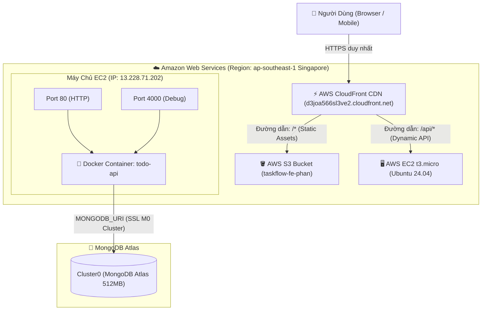
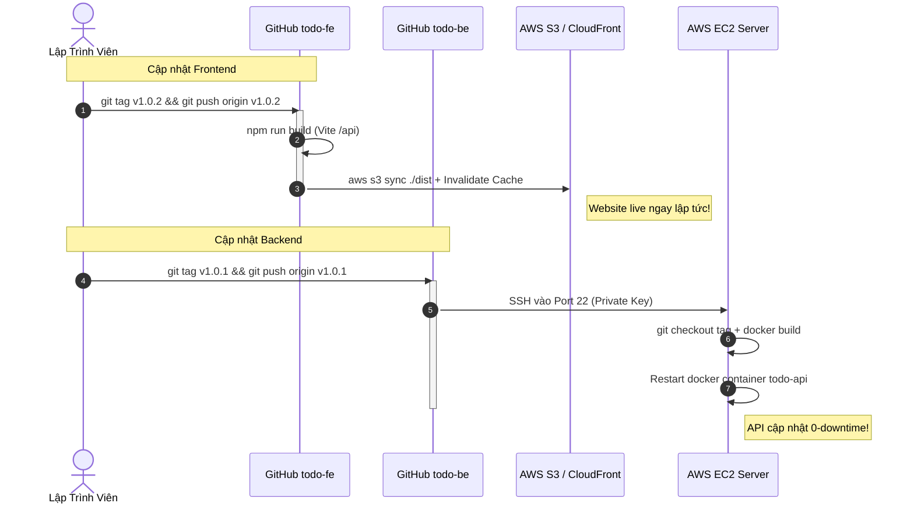

# 🏗️ Tài Liệu Hạ Tầng Hệ Thống & Vận Hành (INFRASTRUCTURE.md)

Tài liệu này ghi lại chi tiết toàn bộ kiến trúc hạ tầng đám mây (**AWS + MongoDB Atlas**), cơ chế định tuyến mạng, cấu hình bảo mật và quy trình tự động hóa **CI/CD** của dự án **TaskFlow**.  
Dùng làm cẩm nang tra cứu khi cần bảo trì, cập nhật hoặc bàn giao hệ thống.

---

## 🧭 1. Sơ Đồ Tổng Quan Kiến Trúc (Architecture Topology)

Hệ thống áp dụng mô hình **Single Domain Reverse Proxy** chuẩn doanh nghiệp: Người dùng chỉ tương tác với 1 tên miền HTTPS duy nhất của AWS CloudFront. CloudFront sẽ tự động phân luồng:
- Các file tĩnh giao diện (`/*`) lấy từ **AWS S3**.
- Các yêu cầu dữ liệu (`/api/*`) chuyển tiếp về máy chủ **AWS EC2 (Docker NestJS)**.



---

## 📦 2. Danh Mục Tài Nguyên Hạ Tầng (Inventory)

### 🔹 A. Frontend Hosting (S3 + CloudFront CDN)
* **AWS S3 Bucket:**
  * **Tên Bucket:** `taskflow-fe-phan`
  * **Vùng (Region):** Asia Pacific (Singapore) `ap-southeast-1`
  * **Quyền riêng tư:** `Block all public access = ON` (Khóa hoàn toàn truy cập trực tiếp từ Internet, chỉ cho phép CloudFront đọc qua cơ chế bảo mật **OAC - Origin Access Control**).
* **AWS CloudFront Distribution:**
  * **Distribution ID:** `E3KXJQMP6ZWPPM`
  * **Tên miền phân phối (Domain):** [https://d3joa566sl3ve2.cloudfront.net](https://d3joa566sl3ve2.cloudfront.net)
  * **Gói cước (Pricing Plan):** Free ($0/month)
  * **Default Root Object:** `index.html`
  * **Cấu hình SPA Error Responses (Xử lý F5 trang):**
    * HTTP `403: Forbidden` ➔ Trả về `/index.html` với mã `200: OK` (TTL: 10s)
    * HTTP `404: Not Found` ➔ Trả về `/index.html` với mã `200: OK` (TTL: 10s)

---

### 🔹 B. Backend Server (AWS EC2 + Docker)
* **Instance ID:** `i-0974a1a785ea7bcb9` (Name: `todo-backend-server`)
* **Loại máy chủ:** `t3.micro` (Thuộc gói AWS Free Tier 750 giờ/tháng)
* **Hệ điều hành:** Ubuntu Server 24.04 LTS
* **Địa chỉ IP Public:** `13.228.71.202`
* **Public IPv4 DNS:** `ec2-13-228-71-202.ap-southeast-1.compute.amazonaws.com`
* **Security Group Inbound Rules:**
  * Port `22` (SSH): Quản trị máy chủ từ xa & GitHub Actions.
  * Port `80` (HTTP): Nhận request chuyển tiếp từ CloudFront CDN.
  * Port `4000` (Custom TCP): Mở trực tiếp để test Swagger Docs hoặc debug khẩn cấp.
* **Môi trường chạy ứng dụng:**
  * Docker Engine + Container tên `todo-api`
  * Lệnh ánh xạ cổng: `-p 4000:4000 -p 80:4000`
  * Đường dẫn mã nguồn trên EC2: `~/todo-be`

---

### 🔹 C. Cơ Sở Dữ Liệu (MongoDB Atlas)
* **Cụm (Cluster):** `Cluster0`
* **Đơn vị chủ quản:** MongoDB Atlas hosted trên hạ tầng AWS Singapore (`ap-southeast-1`).
* **Gói cước:** M0 Sandbox Free vĩnh viễn (512MB RAM & Storage).
* **Network Access:** `0.0.0.0/0` (Active).
* **Database Name:** `todo-db`
* **Collection:** `todos`

---

## 🔀 3. Cơ Chế Định Tuyến Mạng Trên CloudFront (Behaviors)

CloudFront đóng vai trò là Router mặt tiền duy nhất:

| Pattern (Đường dẫn) | Target Origin (Đích đến) | Viewer Protocol | Allowed Methods | Cache Policy | Mục đích |
| :--- | :--- | :--- | :--- | :--- | :--- |
| **`/api/*`** | `ec2-13-228-71-202...` (Port 80 HTTP) | Redirect HTTP to HTTPS | `GET, HEAD, OPTIONS, PUT, POST, PATCH, DELETE` | `CachingDisabled` (AllViewer) | Chuyển tiếp toàn bộ gọi API về NestJS Backend trên EC2, không lưu đệm. |
| **`Default (*)`** | `taskflow-fe-phan.s3...` (S3 OAC) | Redirect HTTP to HTTPS | `GET, HEAD` | `Managed-CachingOptimized` | Phục vụ toàn bộ file tĩnh Frontend (HTML, CSS, JS, ảnh) với tốc độ CDN tối đa. |

---

## 🔄 4. Tự Động Hóa CI/CD (GitHub Actions)

Cả 2 repository đều hoạt động độc lập và tự động triển khai khi tạo Git Tag dạng `v*` (ví dụ: `v1.0.0`, `v1.0.1`...):



### 🔐 Bảng Danh Mục GitHub Secrets Đã Cấu Hình:

#### Repo Frontend (`todo-fe`):
👉 Cài đặt tại: [https://github.com/PhanTruong257/todo-fe/settings/secrets/actions](https://github.com/PhanTruong257/todo-fe/settings/secrets/actions)
1. `AWS_ACCESS_KEY_ID`: IAM Access Key của user `github-actions-deployer`.
2. `AWS_SECRET_ACCESS_KEY`: IAM Secret Access Key.
3. `AWS_S3_BUCKET`: `taskflow-fe-phan`
4. `CLOUDFRONT_DISTRIBUTION_ID`: `E3KXJQMP6ZWPPM`
5. `VITE_API_URL`: `/api`

#### Repo Backend (`todo-be`):
👉 Cài đặt tại: [https://github.com/PhanTruong257/todo-be/settings/secrets/actions](https://github.com/PhanTruong257/todo-be/settings/secrets/actions)
1. `EC2_HOST`: `13.228.71.202`
2. `EC2_USER`: `ubuntu`
3. `EC2_SSH_KEY`: Private Key SSH lưu tại `~/.ssh/github_actions` trên máy EC2.
4. `MONGODB_URI`: Chuỗi kết nối MongoDB Atlas.

---

## 🛠️ 5. Hướng Dẫn Vận Hành Hàng Ngày (Runbook)

### 🚀 Cách Deploy Phiên Bản Mới

#### Deploy Frontend:
```bash
cd frontend
git add .
git commit -m "feat: mô tả thay đổi"
git push origin main
git tag v1.0.2
git push origin v1.0.2
```

#### Deploy Backend:
```bash
cd backend
git add .
git commit -m "feat: mô tả thay đổi"
git push origin main
git tag v1.0.1
git push origin v1.0.1
```

---

### 🔍 Các Lệnh Kiểm Tra & Debug Nhanh Trên EC2

Nếu cần kiểm tra trực tiếp máy chủ EC2 (qua nút **Connect** trên AWS Console hoặc SSH):

```bash
# Xem log thời gian thực của backend:
sudo docker logs -f todo-api

# Xem trạng thái container và tài nguyên CPU/RAM:
sudo docker ps
sudo docker stats todo-api

# Khởi động lại thủ công nếu cần:
sudo docker restart todo-api

# Kiểm tra sức khỏe API cục bộ:
curl http://localhost:4000/api/todos
curl http://localhost:80/api/todos
```

---

### 🌐 Cách Gắn Tên Miền Riêng (Khi Mua Domain Mới)

Nếu sau này bạn mua tên miền riêng (ví dụ: `taskflow.vn`):
1. **Xin chứng chỉ SSL**: Vào **AWS Certificate Manager (ACM)** ở vùng **`us-east-1` (bắt buộc)** ➔ Bấm *Request public certificate* cho `taskflow.vn` và `*.taskflow.vn`.
2. **Gắn vào CloudFront**: Mở Distribution `E3KXJQMP6ZWPPM` ➔ Tab *General* ➔ Bấm *Edit* ➔ Điền tên miền vào mục *Alternate domain name (CNAME)* và chọn chứng chỉ ACM vừa tạo.
3. **Trỏ DNS**: Tại nhà cung cấp tên miền, tạo bản ghi `CNAME` trỏ về `d3joa566sl3ve2.cloudfront.net`.
