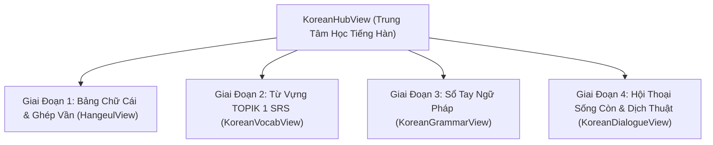

# 🇰🇷 TÀI LIỆU ĐẶC TẢ TÍNH NĂNG: HỆ THỐNG HỌC TIẾNG HÀN (KOREAN LEARNING HUB)

> **Mục đích tài liệu**: Tài liệu này mô tả chi tiết kiến trúc, triết lý sư phạm, tính năng đã xây dựng và định hướng phát triển của phân hệ **Học Tiếng Hàn (Zero to Hero)** trong ứng dụng TaskFlow. Tài liệu được thiết kế đầy đủ, chi tiết và có cấu trúc chuẩn để người dùng có thể gửi trực tiếp cho các AI chuyên gia (ChatGPT, Claude, Gemini...) nhằm tham vấn phản biện, góp ý nâng cấp và mở rộng lộ trình học tập.

---

## 🎯 1. BỐI CẢNH & ĐỐI TƯỢNG NGƯỜI DÙNG (USER PERSONA)

* **Đối tượng học viên**: Người Việt Nam mới bắt đầu học tiếng Hàn từ **con số 0 tuyệt đối** (chưa biết bảng chữ cái, chưa biết cách phát âm, chưa có vốn từ).
* **Mục tiêu học tập**:
  1. Nắm vững bảng chữ cái **Hangeul (한글)** và tự ghép vần, đọc đúng mọi khối chữ tiếng Hàn sau 3 - 5 ngày.
  2. Xây dựng nền tảng từ vựng **TOPIK I (Cấp 1)** cốt lõi thông qua thuật toán lặp lại ngắt quãng **Spaced Repetition (SRS SM-2)**.
  3. Hiểu bản chất các trợ từ ngữ pháp quan trọng nhất và cấu trúc câu ngược (SOV) của tiếng Hàn.
  4. Ứng dụng giao tiếp ngay vào các tình huống thực tế (du lịch, gọi món, hỏi đường, mua sắm).
* **Nền tảng kỹ thuật hiện tại**:
  - **Frontend**: React 19 + TypeScript + Vite. Thiết kế Dark Mode phong cách hiện đại (Glassmorphism, Micro-animations, Touch-friendly trên di động).
  - **Âm thanh**: Web Speech API bản xứ chuẩn giọng `ko-KR` (hỗ trợ điều chỉnh tốc độ 0.65x - 0.9x).
  - **Lưu trữ tiến độ**: Đồng bộ trạng thái thẻ học và điểm đánh giá qua `localStorage` và MongoDB.

---

## 🧭 2. TRIẾT LÝ SƯ PHẠM ĐƯỢC ÁP DỤNG

1. **Hangeul First (Chữ cái là nền móng)**: Khác với tiếng Anh dùng chữ Latinh, tiếng Hàn bắt buộc phải học mặt chữ và cách ghép khối hình vuông trước khi học từ vựng hay ngữ pháp.
2. **Khai thác thế mạnh Gốc Hán-Hàn (Hanja-Vietnamese Advantage)**: Tiếng Hàn có hơn 60% từ vựng gốc Hán (Hanja), có độ tương đồng phát âm rất cao với âm Hán-Việt (ví dụ: `학생` [Hak-saeng] = Học sinh, `식당` [Sik-dang] = Thực đường/Quán ăn, `회사` [Hoe-sa] = Hội xã/Công ty). Việc hiển thị gốc Hán-Hàn giúp người Việt ghi nhớ từ vựng nhanh gấp 3 lần so với học vẹt.
3. **Thuật toán Spaced Repetition (SM-2)**: Chống lại "Đường cong quên lãng" của Ebbinghaus. Các từ khó hoặc quên sẽ được lặp lại ngay trong 1-2 ngày, các từ nhớ tốt sẽ được giãn cách 4-7 ngày.
4. **Hội thoại thực dụng (Survival Dialogues)**: Học các mẫu câu dùng được ngay trong đời sống kèm tính năng nghe đọc chậm để người mới bắt chước khẩu hình và ngữ điệu.

---

## 🏗️ 3. KIẾN TRÚC & CHI TIẾT 4 PHÂN HỆ TÍNH NĂNG ĐÃ TRIỂN KHAI

Hệ thống được đóng gói trong component trung tâm **`KoreanHubView`** với 4 phân hệ tương ứng 4 giai đoạn học:

---

### 🔤 PHÂN HỆ 1: BẢNG CHỮ CÁI HANGEUL & BỘ GHÉP VẦN KHỐI (`HangeulView`)

#### A. Bảng 40 Ký Tự Hangeul Tương Tác:
* **Dữ liệu phân loại**:
  - **10 Nguyên âm cơ bản**: `ㅏ, ㅑ, ㅓ, ㅕ, ㅗ, ㅛ, ㅜ, ㅠ, ㅡ, ㅣ`.
  - **11 Nguyên âm ghép**: `ㅐ, ㅒ, ㅔ, ㅖ, ㅘ, ㅙ, ㅚ, ㅝ, ㅞ, ㅟ, ㅢ`.
  - **14 Phụ âm cơ bản**: `ㄱ, ㄴ, ㄷ, ㄹ, ㅁ, ㅂ, ㅅ, ㅇ, ㅈ, ㅊ, ㅋ, ㅌ, ㅍ, ㅎ`.
  - **5 Phụ âm căng (kép)**: `ㄲ, ㄸ, ㅃ, ㅆ, ㅉ`.
* **Tính năng trên mỗi thẻ ký tự**:
  - Hiển thị mặt chữ Hangeul cỡ lớn, tên chữ cái, phiên âm quốc tế (Romanization).
  - Hướng dẫn khẩu hình và mẹo phát âm bằng tiếng Việt dễ hiểu.
  - Nút loa phát âm giọng chuẩn Hàn Quốc qua Web Speech API.
  - Popup xem chi tiết: Hiển thị từ vựng ví dụ thực tế chứa chữ cái đó (ví dụ: `ㅏ` trong `아이` [Em bé]).

#### B. Bộ Mô Phỏng Ghép Khối Chữ (Syllable Block Builder):
* **Bản chất**: Giúp người học hiểu cách tiếng Hàn xếp các nét thành một khối chữ vuông vắn.
* **Cơ chế chọn 3 thành phần**:
  - Cột 1: Chọn 1 trong 19 Phụ âm đầu (Initial Consonant).
  - Cột 2: Chọn 1 trong 21 Nguyên âm giữa (Medial Vowel).
  - Cột 3: Chọn Phụ âm cuối Patchim (Final Consonant) hoặc để trống.
* **Thuật toán ghép chữ Unicode tự động**:
  $$\text{CharCode} = \text{0xAC00} + (\text{InitIdx} \times 21 + \text{MedIdx}) \times 28 + \text{FinIdx}$$
* **Kết quả**: Khối chữ hoàn chỉnh xuất hiện tức thì (ví dụ: `ㄱ` + `ㅏ` + `ㅁ` = `감`) kèm nút phát âm khối chữ vừa ghép.

#### C. Mini-Quiz Phản Xạ Nhận Diện Chữ:
* 10 câu hỏi trắc nghiệm ngẫu nhiên kiểm tra âm thanh hoặc mặt chữ.
* 4 đáp án lựa chọn, phản hồi đúng/sai tức thì kèm tiếng phát âm.
* Bảng thống kê điểm số và nút chơi lại để luyện phản xạ.

---

### 🎴 PHÂN HỆ 2: KHO TỪ VỰNG TOPIK 1 & FLASHCARD SRS (`KoreanVocabView`)

#### A. Kho Từ Vựng Phân Loại Theo 8 Chủ Đề Thiết Yếu:
1. 🙋 Chào hỏi & Xã giao (`안녕하세요, 감사합니다, 죄송합니다...`)
2. 🔢 Số đếm & Thời gian (Số Hán-Hàn `일, 이, 삼` vs Số Thuần Hàn `하나, 둘, 셋`)
3. 🍜 Ẩm thực & Nhà hàng (`밥, 물, 김치, 식당, 맛있다...`)
4. 👨‍👩‍👧 Gia đình & Con người (`가족, 아버지, 어머니, 친구...`)
5. 🏠 Đồ vật & Đời sống thường nhật (`집, 방, 책, 옷...`)
6. 🏫 Trường học & Công việc (`학생, 선생님, 학교, 회사, 한국어...`)
7. 🗺️ Địa điểm & Mua sắm (`돈, 얼마예요, 어디, 화장실...`)
8. 💖 Tính từ & Cảm xúc (`좋다, 예쁘다, 재미있다...`)

#### B. Thẻ Học 3D (3D Flip Flashcard):
* **Mặt trước (Front)**: Chữ Hangeul cỡ lớn nổi bật, phiên âm La-tinh `[an-nyeong-ha-se-yo]`, tag cấp độ TOPIK 1, nút nghe phát âm bản xứ.
* **Mặt sau (Back)**:
  - Nghĩa tiếng Việt chuẩn xác.
  - **Huy hiệu Gốc Hán-Hàn**: Hiển thị rõ âm Hán-Việt và chữ Hán tương ứng (ví dụ: `학생` -> Học Sinh [學生], `회사` -> Hội Xã [會社]).
  - Câu ví dụ thực tế song ngữ Hàn - Việt.

#### C. Thuật toán Lặp Lại Ngắt Quãng (SuperMemo-2 / SM-2):
* Cung cấp 4 nút đánh giá độ nhớ:
  - **Quên (`again`)**: Reset khoảng cách về 1 ngày, giảm Ease Factor.
  - **Hơi khó (`hard`)**: Khoảng cách ôn sau 2 ngày.
  - **Nhớ tốt (`good`)**: Khoảng cách tăng theo Ease Factor (+4 ngày).
  - **Quá dễ (`easy`)**: Khoảng cách tăng nhanh (+7 ngày), tăng Ease Factor.
* Tự động lọc danh sách "Từ cần ôn hôm nay" (Due Queue) và chia mẻ 15 từ mỗi đợt.
* Toàn bộ tiến độ và trạng thái thẻ (`new`, `learning`, `mastered`) được lưu bền vững vào `localStorage`.

---

### 📐 PHÂN HỆ 3: SỔ TAY NGỮ PHÁP SƠ CẤP CỐT LÕI (`KoreanGrammarView`)

Tổng hợp 8 chủ điểm ngữ pháp nền tảng bắt buộc phải biết của tiếng Hàn sơ cấp:
1. **Trật tự câu cơ bản: SOV**: Phân tích sự đảo trật tự so với tiếng Việt (Chủ ngữ + Tân ngữ + Động từ).
2. **Trợ từ chủ đề `은 / 는`**: Quy tắc có patchim đi với `은`, không patchim đi với `는`.
3. **Trợ từ chủ ngữ `이 / 가`**: Nhấn mạnh chủ thể thực hiện hành động.
4. **Trợ từ tân ngữ `을 / 를`**: Xác định đối tượng chịu tác động.
5. **Trợ từ thời gian & nơi chốn `에 / 에서`**: Phân biệt điểm đến/thời điểm (`에`) với nơi diễn ra hành động cụ thể (`에서`).
6. **Đuôi câu thân mật lịch sự đời thường `-아요 / -어요 / -여요`**: Quy tắc hòa âm nguyên âm dương tính (ㅏ, ㅗ) và nguyên âm âm tính; biến đổi đặc biệt của đuôi `하다 -> 해요`.
7. **Đuôi câu trang trọng `-ㅂ니다 / -습니다`**: Dùng trong công sở, tin tức, phỏng vấn.
8. **Đuôi câu mong muốn `-고 싶다` & Phủ định `안 / -지 않다`**: "Tôi muốn..." và "Không...".

* **Cấu trúc mỗi bài học**:
  - Tiêu đề & Công thức toán học trực quan (Formula Badge).
  - Giải thích bản chất ngữ pháp bằng ngôn ngữ bình dân.
  - Hộp mẹo nhớ nhanh (Tips Box) cảnh báo các lỗi người Việt hay mắc phải.
  - Bảng câu ví dụ thực tế có phân tích cấu trúc từng từ và nút nghe phát âm tiếng Hàn.
  - Hỗ trợ Mở rộng / Thu gọn (Accordion) linh hoạt.

---

### 💬 PHÂN HỆ 4: HỘI THOẠI SỐNG CÒN & CÔNG CỤ DỊCH THUẬT (`KoreanDialogueView`)

#### A. 60+ Mẫu Câu Giao Tiếp Theo Tình Huống:
* Phân loại theo 5 ngữ cảnh cấp thiết: Chào hỏi, Gọi món nhà hàng (xin bớt cay, xin nước, tính tiền), Mua sắm trả giá, Đi lại/Hỏi đường/Taxi, Khẩn cấp cần giúp đỡ.
* **Tính năng phát âm kép (Dual-Speed Audio)**:
  - Nút loa chuẩn (🔊, tốc độ 0.9x): Nghe ngữ điệu tự nhiên của người Hàn.
  - Nút rùa chậm (🐢, tốc độ 0.65x): Nghe rõ ràng từng âm tiết để người mới bắt chước theo.

#### B. Công Cụ Dịch Nhanh 2 Chiều (Hàn ⇄ Việt):
* Hỗ trợ dịch nhanh câu văn, cụm từ giữa tiếng Hàn và tiếng Việt.
* Sử dụng Google Translation Client API (không phụ thuộc API key phức tạp).
* Tích hợp các nút tiện ích:
  - Nghe phát âm câu tiếng Hàn vừa dịch.
  - Nút Copy bản dịch 1-chạm.
  - **Nút "Lưu vào Flashcard"**: Tự động chuyển câu/từ vừa dịch thành 1 thẻ từ vựng mới đưa vào thuật toán SRS để học thuộc.

---

## ❓ 4. CÁC CÂU HỎI & VẤN ĐỀ CẦN THAM VẤN Ý KIẾN TỪ AI CHUYÊN GIA

> 💬 *Bạn có thể copy toàn bộ phần dưới đây gửi kèm cho AI khác để nhận góp ý chuyên sâu:*

### Câu hỏi 1: Về Lộ trình & Sư phạm Ngôn ngữ (Curriculum & Pedagogy)
1. Lộ trình 4 giai đoạn hiện tại (`Hangeul` ➔ `TOPIK 1 Vocab` ➔ `Ngữ pháp căn bản` ➔ `Giao tiếp & Dịch`) đã đủ hợp lý cho người tự học từ số 0 chưa?
2. Có nên tách riêng một bài học chuyên sâu về **Quy tắc biến âm tiếng Hàn (Batchim Rules: nối âm, nhũ hóa, mũi hóa, biến âm vòm)** trước khi cho học viên bước vào học từ vựng không?
3. Cách giảng dạy từ vựng dựa trên **Gốc từ Hán-Hàn (Hanja)** cho người Việt có điểm nào cần lưu ý để tránh việc người học bị nhầm lẫn nghĩa trong tiếng Hàn hiện đại?

### Câu hỏi 2: Về Tính năng Tương tác & Trải nghiệm Người Dùng (UX & Features)
1. Để người mới không bị nản khi học bảng chữ cái Hangeul, có nên bổ sung tính năng **Tập viết chữ (Stroke Order / Canvas Drawing)** để vẽ nét chữ trên màn hình cảm ứng không?
2. Có nên bổ sung **Bộ luyện gõ bàn phím tiếng Hàn (2-Set Korean Keyboard Trainer)** trực tiếp trên web để người dùng quen vị trí phím chữ Hangeul trên máy tính/điện thoại?
3. Chế độ luyện nghe chép chính tả (Dictation) hoặc luyện nói đối thoại phản xạ (Shadowing) nên được tích hợp ở giai đoạn nào là phù hợp nhất?

### Câu hỏi 3: Về Cơ chế Giữ chân Học viên (Gamification & Retention)
1. Ngoài chuỗi ngày học liên tục (Streak 🔥), những yếu tố Gamification nào (XP, Level, Huy hiệu TOPIK Pass, Nhiệm vụ hàng ngày 5 phút) sẽ tạo động lực học tiếng Hàn tốt nhất?
2. Có kho dữ liệu từ vựng mở (Open-source Dataset) nào chuẩn TOPIK I (khoảng 800 - 1500 từ) có sẵn nghĩa tiếng Việt chất lượng cao mà hệ thống nên tích hợp thêm?

---

*Tài liệu được khởi tạo và lưu trữ tại `docs/KOREAN_LEARNING_SPEC.md` - Dự án TaskFlow.*
